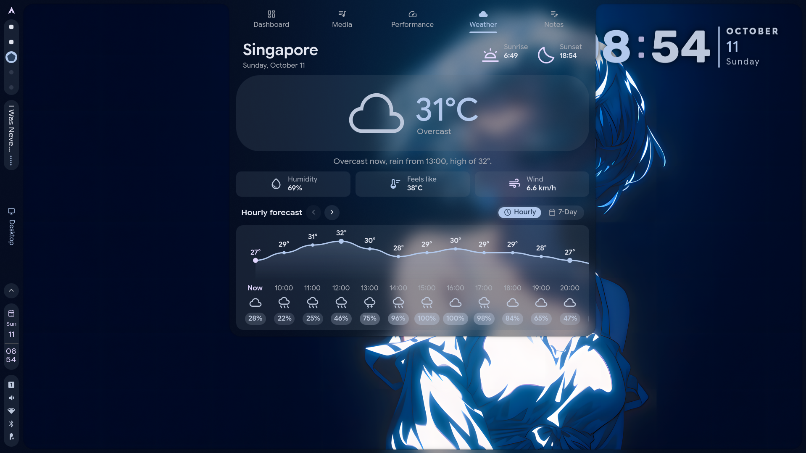
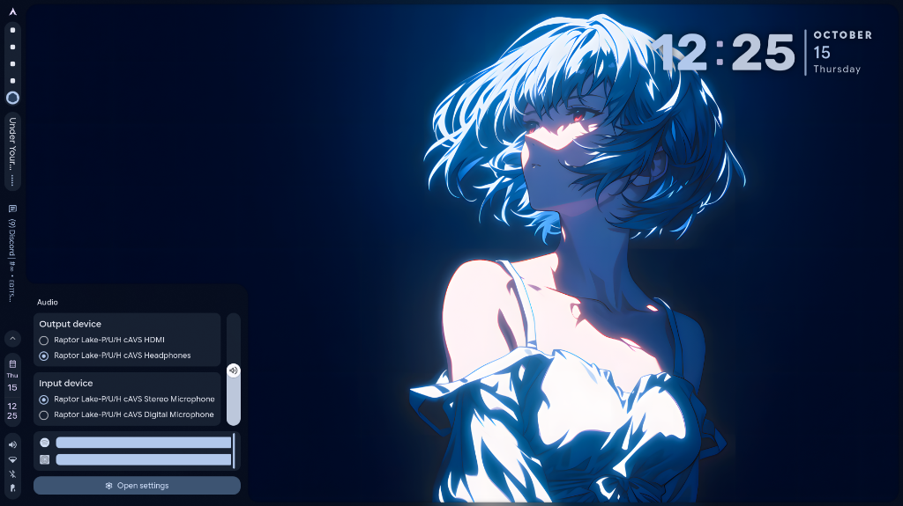

<h1 align=center>Vacuited Shell</h1>

<div align=center>

&nbsp;&nbsp;

A personal fork of [caelestia-dots/shell](https://github.com/caelestia-dots/shell) based on [midnight-shell](https://github.com/dim-ghub/midnight-shell).

</div>

> [!WARNING]
> **Built for my machine first.** These features and hardware controls are tailored for my own setup (HP Victus 15) and are not guaranteed to work reliably everywhere. Behavior may differ on your system. Use at your own *risk*.

## Features

### Vacuited shell

| Feature | Description | Status & Implementation |
| :--- | :--- | :--- |
| **Wallpaper Engine Auto-Pause** | Automatically suspends `linux-wallpaperengine` (`SIGSTOP`) behind windows or on battery power | Drops CPU/GPU usage to 0%, resumes instantly (`SIGCONT`) upon desktop exposure |
| **Zero-Flash WE Transitions** | Preserves previous frame during engine startup (`holdSource`) | Eliminates black screens, low-res flashes, and stutter between live wallpapers |
| **GPU-Cached `.ktx` Thumbnails** | BC3 GPU-compressed `.ktx` thumbnail pipeline (`Caelestia.Multimedia`) | Instantaneous zero-lag wallpaper picker loading even with 6K PNG libraries |
| **Caelestia Notes Integration** | Built-in notes workspace pinned to the dashboard and accessible via launcher | Persistent store (`NotesStore.qml`), markdown editing, dynamic M3 surface colors |
| **Hourly Weather Forecast** | Animated 7-day temperature curve with rain probability and conditions | Collapsed behind a fluid sliding toggle pill (`[ Hourly \| 7-Day ]`) with cached tabs |
| **Lilith AI Assistant & Sidebar** | Modular sidebar assistant with headless `AiEngine` and dynamic `+18%` width expansion | Slash commands (`/new`, `/model`, `/tools`, `/history`), `<think>` blocks, tool cards, Vision, Spotify, Tavily |
| **HP Victus Hardware Controls** | Live fan RPM gauges, platform profiles, refresh rate, and Intel Turbo Boost | Dedicated hero dashboard tab and battery popout toggle backed by `vacuited-cli` |
| **Keep Awake Inhibitor** | Tri-state idle inhibitor toggle (`[ Off \| Prevent Sleep \| Prevent Lock & Sleep ]`) | Utilities card integration for presentations, long downloads, or active monitoring |
| **Vertical Audio Popout** | Redesigned volume interface with vertical master slider and device cards | Filters background wallpaper audio streams; includes dynamic M3 tinted app icons |
| **Google Lens Screen Search** | Regional Google Lens search button in Utilities (`center_focus_strong`) | Triggers area selection, uploads region, and opens results in default browser |
| **Nexus Night Mode** | Blue-light filter quick toggle (`dark_mode`) & live color temperature slider (`1000 K – 6500 K`) | Flicker-free live gamma adjustment via `hyprsunset` daemon and `hyprctl hyprsunset` IPC |
| **Draggable Quick Toggles** | Nexus settings editor (`Panels > Utilities`) with drag-and-drop reordering | Custom positioning, visibility toggles, removal, and entry restoration dialog |
| **Hyprshutdown Graceful Exits** | Graceful session termination dialog with Caelestia M3 cards and blur | Seamless application teardown before session `logout`, `shutdown`, and `reboot` |

### Inherited Midnight

| Category | Features |
| :--- | :--- |
| **Launchers** | Emoji and glyph picker, clipboard history manager, window switcher, and keybinds list |
| **Wallpapers** | Native GIF and video wallpaper playback with auto-pause, plus Wallhaven integration |
| **Visual Effects & Easter Eggs** | Bad Apple shader effect masking the background, Bezel mode, and dynamic palette extraction |
| **Mini-Games & Utilities** | Playable Chrome Dino runner inside the notification dock |
| **Dashboard** | Developer console terminal tab with history and autocomplete, system telemetry, and weather |
| **Status Bar & Dock** | macOS-style dock, Material workspace shapes, DND toggle, and live drag-and-drop editor |
| **Desktop Gadgets** | Floating desktop lyrics with background blur, Shimeji screen pets, and desktop clock |
| **Lock Screen** | Configurable auto-lock on startup (`lockOnStartup`), redesigned profile and clock layout |
| **Hyprland Integration** | Window focus and dispatching commands via Lua (`hl.dsp`) |
| **QuickShare & Polkit** | Android file transfers via Avahi daemon; built-in animated Polkit authentication daemon |

## Highlights & Changes

### Wallpaper Engine Zero-Flicker, Battery Suspend & `.ktx` GPU Cache
- Automatically suspends `linux-wallpaperengine` (`SIGSTOP`) when covered by windows or on battery power to reduce CPU/GPU usage to 0%, resuming instantly (`SIGCONT`) when visible.
- Preserves the previous wallpaper frame during the 1.2s engine startup delay to eliminate black frames and stretched low-res thumbnail flashes.
- Uses `Caelestia.Multimedia` (`Visual`) with `rgbcx` BC3 GPU-compressed `.ktx` texture caching (`~/.cache/caelestia/multimedia/image/`) for instant, zero-lag thumbnail rendering in both the Launcher and Nexus wallpaper pickers.
- Animated GIF thumbnails (`CachingAnimatedImage`) play only on the active/centered carousel item to conserve resources.
- Automatically falls back to the previous working wallpaper if an engine crash occurs.

### Caelestia Notes
- Integrated [Caelestia Notes](https://github.com/Denzils-repo/Caelestia_Notes) directly into the shell dashboard and launcher.
- Tab order preserved at the far right of the dashboard tabs (cuz i like that way).

### Hourly Weather Forecast
- Integrated [Caelestia Hourly Weather](https://github.com/ItsXyzzy/Caelestia-Hourly-Weather) into the weather tab with a scrollable 7-day temperature curve, rain chance, and day summary.
- Collapsed hourly and 7-day forecasts behind an animated toggle pill (`[ Hourly | 7-Day ]`) to keep the dashboard compact.
- Gated initial height animations and cached active tabs for fluid 144 FPS swiping without curve re-tessellation lag.



### Lilith AI Assistant & Sidebar Architecture
- **Headless background engine (`AiEngine.qml`)**: Decouples SSE/NDJSON streaming, multi-turn `ai_tools.py` execution, `<think>` reasoning tag extraction, and v2 session persistence (`~/.config/caelestia/ai_chats.json`) from sidebar drawer open/close lifecycles.
- **Dynamic sidebar width & expanding pill header**: Smoothly expands the sidebar width by `+18%` (`430px` → `507px`) when switching to the `Lilith` tab, paired with a centered dynamic expanding pill navigation header (`Notifications`, `Lilith`, `News`).
- **Modular UI & slash command palette**: Decomposed into dedicated components (`ThinkingBlock`, `ToolCallBlock`, `MessageBubble` with 1-click `wl-copy` code blocks, `ChatView` with intelligent scroll-lock, `LilithMascot`, `PromptComposer` with docked model chip & tool toggles, `SlashMenu` for `/new`, `/reset`, `/clear`, `/history`, `/model`, `/tools`, `ModelPickerModal`, and `HistorySheet`).
- **Dedicated global shortcuts**: Instant toggle & input auto-focus via `caelestia:aiAssistant` (`SUPER + A`) and fresh chat creation via `caelestia:aiAssistantNew` (`SUPER + SHIFT + A`).
- **Nexus subpage configuration**: Provider and tool configuration panels directly in Nexus (`Nexus > Panels > Sidebar > AI Providers` / `AI Tools`).
- **Multi-provider & smart tool suite**: Custom OpenAI-compatible endpoints, OpenRouter, Gemini, Vision screenshots (`grim` + `hyprctl`), clipboard read/write (`wl-paste` / `wl-copy`), Spotify (`spotify_search`, `spotify_play`, `spotify_status`), reminders (`~/.config/caelestia/ai_reminders.json`), long-term memory (`~/.config/caelestia/ai_memory.json`), and Tavily web search.

### Hardware Controls
- **Hero fan telemetry**: Dedicated CPU and GPU fan cards featuring live spinning fan discs, RPM counters, temperature pills, and live GPU wattage.
- **3-column hardware toggles**: Instant switching for fan mode (`[ Auto | Max Boost ]`), Intel Turbo Boost (`[ Base | Boost ]`), and display refresh rate (`[ 60 Hz | 144 Hz ]`).
- **4-profile power & thermal selector**: Full-width selector for `[ Quiet | Cool | Balanced | Performance ]` with instant sync across ACPI platform profiles, battery popout, and power-profiles-daemon.
- **Battery popout cool mode**: Extended the status bar battery popout with a native 4th `Cool` profile button and liquid tank indicators.
- **Seamless backend integration**: Backed by `vacuited-cli` (`caelestia hardware`) and a Polkit helper for zero-password transitions.
- **Automatic hardware detection**: Tailored specifically for the **HP Victus 15** (`hp-wmi`, dual fans, `intel_pstate`, and RTX 40 series). Unsupported systems automatically hide the tab without logging errors.

### Keep Awake & Idle Inhibitor
- Integrated a 3-button power control into the utilities card (`[ Off | Prevent Sleep | Prevent Lock & Sleep ]`).
- Prevents idle timeouts from turning displays off or suspending during long downloads or presentations.

### Audio Popout Redesign
- Repositioned the primary volume slider vertically alongside output and input device cards using a compact M3 filled pill.
- Streamlined per-application volume controls directly above settings with dynamic M3-recolourable app icons, full-width sliders, and automatic background wallpaper stream filtering.



### Utilities Quick Toggles & Google Lens
- **Google Lens screen search**: Added a dedicated `center_focus_strong` quick toggle to the Utilities drawer to instantly capture screen regions and query Google Lens.
- **Interactive drag-and-drop editor**: Nexus settings (`Nexus > Panels > Utilities`) now features a draggable `ListEditor` allowing complete reordering, toggling, removing, and re-adding of quick toggle buttons.
- **Screenshot mode isolation**: Resolved an issue where `searchMode` persisted in `AreaPicker`, preventing standard screenshot tools from opening until shell reload.

### Hyprshutdown Graceful Session Controls & Blur Layer Rules
- **graceful session teardown**: integrated `hyprshutdown` across session controls (`logout`, `shutdown`, `reboot`), displaying active running applications in an M3 modal card before exiting.
- **dynamic blur layer-rules**: configured real-time hyprland blur and ignore-alpha layer-rules for the `hyprshutdown` namespace in `Colours.qml`.

## Global Shortcuts

All shell toggles and menus can be bound via Hyprland [global shortcuts](https://wiki.hypr.land/Configuring/Basics/Binds/#dbus-global-shortcuts).

| Shortcut Name | Description |
| :--- | :--- |
| `caelestia:launcher` | Toggle application launcher |
| `caelestia:dashboard` | Toggle system dashboard |
| `caelestia:controlCenter` | Open control center / quick toggles |
| `caelestia:sidebar` | Toggle notification / AI / news sidebar |
| `caelestia:aiAssistant` | Toggle Lilith AI assistant tab with instant input focus |
| `caelestia:aiAssistantNew` | Open Lilith AI assistant on a fresh chat session |
| `caelestia:utilities` | Toggle utilities drawer |
| `caelestia:session` | Toggle power / session menu |
| `caelestia:emoji` | Open emoji and glyph picker |
| `caelestia:clipboard` | Open clipboard history manager |
| `caelestia:windowSwitcher` | Open active window switcher |
| `caelestia:keybinds` | Open keybinds list |
| `caelestia:wallpaper` | Open wallpaper selector |
| `caelestia:terminal` | Toggle developer terminal drawer |

### Hyprland Bind Examples

Add these lines to your Hyprland configuration (`~/.config/hypr/hyprland.conf` or user config):

```conf
# Launchers & menus
bind = SUPER, SPACE, global, caelestia:launcher
bind = SUPER, RETURN, global, caelestia:launcher
bind = SUPER, S, global, caelestia:controlCenter
bind = SUPER, D, global, caelestia:dashboard
bind = SUPER, N, global, caelestia:sidebar
bind = SUPER, A, global, caelestia:aiAssistant
bind = SUPER SHIFT, A, global, caelestia:aiAssistantNew
bind = SUPER, M, global, caelestia:utilities

# Sub-tools & pickers
bind = SUPER, E, global, caelestia:emoji
bind = SUPER, V, global, caelestia:clipboard
bind = SUPER, W, global, caelestia:windowSwitcher
bind = SUPER, K, global, caelestia:keybinds
bind = SUPER, B, global, caelestia:wallpaper
bind = SUPER, T, global, caelestia:terminal
```

## Installation & Build

### Prerequisites

Ensure you have Quickshell and core dependencies installed:
- `quickshell-git`
- `brightnessctl`, `ddcutil`, `libpipewire`, `wireplumber`, `networkmanager`
- `qt6-base`, `qt6-declarative`, `cmake`, `ninja`

### Manual Build

To build the shell plugin and install directly to your local configuration:

```bash
# Clone the repository
git clone https://github.com/vacuited/shell.git ~/.config/quickshell/caelestia
cd ~/.config/quickshell/caelestia

# Build and install the QML plugin locally
cmake -B build -G Ninja -DCMAKE_BUILD_TYPE=Release -DCMAKE_INSTALL_PREFIX=/ -DINSTALL_QSCONFDIR="$HOME/.config/quickshell/caelestia"
cmake --build build
sudo cmake --install build
sudo chown -R $USER ~/.config/quickshell/caelestia
```

To run or restart the shell daemon:

```bash
caelestia shell -d -r
```

## Configuration

All shell options are configured via `~/.config/caelestia/shell.json`.

Per-monitor overrides can be placed in `~/.config/caelestia/monitors/<monitor_name>/shell.json`. Get connected monitor names via `hyprctl monitors -j | jq -r '.[].name'`.

</details>

## Credits

| Project | Upstream / Source | Contribution |
| :--- | :--- | :--- |
| **Caelestia Shell** | [caelestia-dots/shell](https://github.com/caelestia-dots/shell) | Original Quickshell desktop environment |
| **Midnight Shell** | [dim-ghub/midnight-shell](https://github.com/dim-ghub/midnight-shell) | Base fork with initial styling, launchers, and extensions |
| **Caelestia Notes** | [Denzils-repo/Caelestia_Notes](https://github.com/Denzils-repo/Caelestia_Notes) | Notes tab component and store logic |
| **Caelestia Hourly Weather** | [ItsXyzzy/Caelestia-Hourly-Weather](https://github.com/ItsXyzzy/Caelestia-Hourly-Weather) | Hourly forecast and spline temperature curve |
| **Nexus Night Mode** | [AEON-mod/Scripts](https://github.com/AEON-mod/Scripts/tree/main/Nexus-NightMode) | `HyprSunset` service, quick toggle, and live temperature slider |
| **Quickshell** | [outfoxxed/quickshell](https://quickshell.outfoxxed.me) | Flexible Qt6 desktop shell toolkit |
